

# Indian Market Disclosures in One Place {: .nobreak }

**A free data platform and web application for India's public stock market disclosures**

Project review report

**Author:** Markandeya Varma  
**Date:** 7 November 2026

<!--TOC-->

## 1. Introduction

Every day, Indian stock exchanges and regulators publish a lot of useful information for free. They publish who made large trades, who owns each company, how much foreign investors bought and sold, what each mutual fund holds, and what profit each company made.

All of this is public, and anybody can read it. But reading it is not easy. The information is spread over many websites and in many file formats. Some of it is removed the very next day.

This project collects all of that information every evening, keeps it safely, cleans it, and shows it in one simple website.

### What I built

I built three things that work together:

- **A collector.** It runs by itself every evening. It downloads the day's files and keeps the original copies.
- **A database.** It turns those files into clean tables and links everything to the right company.
- **A web application.** It lets anyone look up a stock, a fund, an investor or a day's trades in one place.

### Why I chose this project

I started this project because I wanted to understand whether large investors' public trades tell us anything about share prices. To answer that, I first needed the data. I then found that collecting it was the hardest part of the whole job.

So the data platform became the main work, and the question about share prices became one of the things it can be used for.

### What this project does not do

This project is not a trading system, and three things make that clear:

- It does not place any orders, and it holds no money.
- It does not tell anyone to buy or sell a share. It gives no scores or ratings.
- It only shows what was officially disclosed, and it says where each number came from.

## 2. The problem

**The data is free, but there is no single proper place to get all of it.**

I looked for one free place that had all of this data together, going back many years. I could not find one. Paid terminals exist, and free websites each cover some parts, but I had to go to many different places to build the full picture of even one company.

The problem has six parts.

### 2.1 The data is scattered

To understand one company, you may need to visit all of these:

| What you want to know | Where it is published |
|---|---|
| Who made a large trade today | NSE, as a daily list |
| What the share price and delivery were | NSE, in daily files |
| Who owns the company | Quarterly filings on NSE and BSE |
| What profit it made | Quarterly filings on NSE |
| Did the promoters buy or sell | NSE insider trading filings |
| How much foreign investors bought overall | NSDL |
| Which mutual funds hold it | Each fund house's own website |

No single page joins these together. For mutual funds it is especially hard, because each fund house publishes its own files on its own website, in its own layout.

### 2.2 Some data disappears

This surprised me the most. Some pages only show the current day, and the next day the old information is gone.

| Data | How long it stays available |
|---|---|
| NSE bulk and block deals | Current day only. The history service returned an error when I tried it |
| FII and DII cash figures | Current day only |
| Insider trades | A rolling window of about four months |

So if nobody saves this data on the day, it may be lost for good. My own project lost 33 sessions of bulk deals from 2026 this way, and those days cannot be recovered.

### 2.3 Every source has a different format

The data comes as CSV files, JSON from websites, XBRL files for financial results, and Excel files from fund houses. Each one has to be read in its own way, and a format can change without notice.

### 2.4 The same thing has many names

This is a bigger problem than it sounds.

- **Companies change names and symbols.** CADILAHC became ZYDUSLIFE, for example. A simple search on the new symbol misses the old history.
- **Investors are spelled in many ways.** One institution can appear under several spellings in the trade lists. I found about 29,877 different spellings, which group into about 27,998 participants.
- **Share splits change the price.** After a 1-for-2 split, the price falls by half on paper, though nobody has lost money. Without correcting for this, charts show false crashes.

### 2.5 The raw lists can mislead

Much of the bulk deal list is not long-term investors at all. In the 6 November session, 59% of the rows were same-day round trips, where one party bought and sold the same share on the same day. A person reading the raw list could easily believe big investors were buying, when these were mostly high-frequency traders.

### 2.6 It is hard for a new person

A student or a new investor does not know where to start. Even a person who knows the sources has to download files, clean them, and match them by hand. That takes many days before they can ask a single question.

### The goal

So the goal of this project became simple:

> Bring India's free market disclosures into one place, keep them safe, make them correct, and make them easy to read.

## 3. How I solved it

The solution has seven simple steps. Each one fixes a part of the problem above.

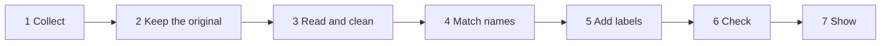

*The seven steps, from a public file to a page on the website.*

### Step 1: Collect every evening

A scheduled job starts by itself at 18:30 and again at 21:00, every day, because some files are published late. Nobody has to press a button. This fixes the problem of disappearing data, because each day's file is saved on the day.

### Step 2: Keep the original file

Each file is saved exactly as it was downloaded, compressed, and given a unique fingerprint called a hash. These files are never changed. If I later find a mistake in how I read a file, I can read it again from the original.

The archive now holds more than 1,92,000 files.

### Step 3: Read and clean

A small reader for each format turns the file into a clean table. This fixes the problem of many formats, because everything after this step looks the same.

### Step 4: Match the names

Each company gets one record, based on its ISIN, which is a code that stays with the share. The system also remembers which symbol was valid on which dates. So old and new names lead to the same company.

Investor spellings are grouped in the same way, so one institution is shown as one participant.

### Step 5: Add labels

The system labels each participant as a mutual fund, a foreign institution, an individual, a company and so on. It also finds high-frequency traders from what they do, not from their names: if a party buys and sells the same share on the same day again and again, it gets that label.

On the website, these round trips are folded away by default, and one click shows them. This fixes the misleading lists.

### Step 6: Check everything

I do not assume the data is right. I test it:

- **1290 automated tests** check the code and the data.
- I compared my share prices with a separate source across 2,651 companies. This found 226 missed splits and bonuses, which I corrected, and 203 bad one-day prices, which I removed.
- A health check runs after every collection and reports any source that has gone stale.

### Step 7: Show it simply

The website shows everything in one place, with plain explanations next to the numbers. A blank is left blank. The website never fills a gap with a guess.

### Three rules I followed

- **Show facts, not advice.** The website does not say buy or sell. This is also the safe side of SEBI's rules for anyone who is not a registered adviser.
- **Respect the websites.** I download public files at a slow rate. Where a fund house blocks automated access, I leave it out, and the website says which houses are covered.
- **Be honest about gaps.** If data is missing, the system records this. It does not hide it.

## 4. The data sources and the database

### 4.1 Where the data comes from

| Source | What I collect |
|---|---|
| **NSE** | Bulk and block deals, daily prices, delivery figures, F&O contracts, positions by participant type, FII and DII cash, index values and members, corporate actions, insider trades, quarterly results, shareholding filings, announcements, board meetings and promoter pledges |
| **BSE** | Shareholding filings |
| **NSDL** | Foreign portfolio investor flows |
| **28 mutual fund houses** | Month-end portfolios of their schemes, from each house's own website |
| **Earlier work** | The history I collected in the first version of this project, including records the exchanges no longer serve |

### 4.2 How much data there is

These are the numbers from the system's own coverage report.

| Data | Rows | From | To |
|---|---:|---|---|
| Daily share prices | 78,80,786 | Jan 2005 | Nov 2026 |
| F&O contracts | 18,11,60,973 | Jan 2005 | Nov 2026 |
| Delivery figures | 87,69,965 | Jan 2006 | Nov 2026 |
| Bulk and block deals | 2,45,657 | Jan 2006 | Nov 2026 |
| Foreign investor flows | 51,756 | Dec 1998 | Nov 2026 |
| Index total return values | 7,893 | Jan 1995 | Nov 2026 |
| Quarterly results | 76,920 | Mar 2005 | Sep 2026 |
| Shareholding rows | 23,38,249 | Mar 2008 | Oct 2026 |
| Named shareholders above 1% | 16,72,761 | Mar 2008 | Oct 2026 |
| Mutual fund holdings | 27,86,334 | Sep 2012 | Oct 2026 |
| Insider trades, from earlier work | 2,83,281 | 2016 | mid 2026 |
| Insider trades, collected directly | 6,710 | May 2024 | Nov 2026 |

In total, the project holds about 19 GB of data on disk.

### 4.3 What each kind of data means

**Bulk deal.** When one client trades more than 0.5% of a company's shares in a day, the exchange must publish it, with the client's name.

**Block deal.** A large trade made in a special window of the exchange.

**Delivery.** The share of traded quantity that really changed hands, and was not just bought and sold within the day.

**FII and DII.** Foreign and domestic institutions. Their daily totals show which way big money moved.

**F&O positions.** How many futures contracts each group of traders holds. This is different from buying shares, and the website keeps the two apart.

**Shareholding pattern.** Every quarter, each company files who owns it: promoters, foreign investors, mutual funds and the public.

**Insider trades.** When promoters or senior staff trade their own company's shares, they must disclose it.

**Mutual fund portfolio.** Every month, each fund house publishes what each of its schemes holds.

### 4.4 How the data is stored

The storage has four layers. Data moves one way, from top to bottom.

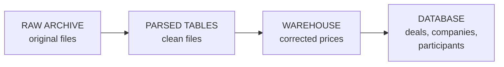

*The four storage layers.*

| Layer | What it holds | Size |
|---|---|---|
| Raw archive | Original downloaded files | 3.8 GB |
| Parsed tables | Clean Parquet files | 417 MB |
| Warehouse | Price tables and comparison groups | 5.5 GB |
| Databases | Linked tables and the project's records | 1.2 GB |

Only the raw archive is precious. Everything below it can be rebuilt from it.

### 4.5 The main database tables

| Table | Rows | What it holds |
|---|---:|---|
| `security_master` | 3,421 | One record per company |
| `symbol_history` | 3,735 | Which symbol was valid when |
| `participant_master` | 27,998 | One record per investor |
| `participant_aliases` | 29,877 | Each spelling, and who it belongs to |
| `institutional_deals_raw` | 2,45,657 | Deals exactly as filed |
| `institutional_deals_clean` | 2,45,657 | Deals with labels and flags |
| `participant_oi` | 15,819 | Daily F&O positions by group |
| `promoter_entities` | 1,05,357 | Promoters named in company filings |

### 4.6 What is missing

I keep a record of what the data does not have.

| Gap | Reason |
|---|---|
| 33 sessions of NSE bulk deals in 2026 | NSE no longer serves them |
| BSE bulk and block deals | The BSE route I tested returned an error page |
| Some fund houses, such as Kotak, Bandhan and Axis | Their sites block automated access or encrypt the data |
| Industry labels before 2016 | No free source with dates was available |
| Some large one-day price moves | 2,566 are flagged and listed, and 312 of them are not yet explained |

## 5. System architecture

### 5.1 The big picture

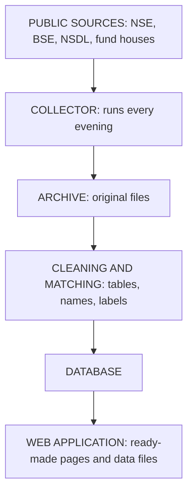

*How data travels from a public website to the user.*

The design is one straight line. The website never talks to the exchange and never touches the live database. It only reads ready-made files. So the website stays fast, and it keeps working even while new data is being collected.

### 5.2 What happens every evening

1. At 18:30, the scheduler starts the job.
2. The system downloads the day's files and saves the originals.
3. It reads them into tables, and updates prices, names and labels.
4. It makes an encrypted backup to Google Drive and runs a health check.
5. It rebuilds the website.
6. It sends a report by Telegram and email.

The run has 33 recorded stages. Each stage records whether it passed and how long it took. If one stage fails, the rest continue, and the report names the stage that failed.

A second pass runs at 21:00, for anything published late. A shareholding job runs at 18:45, and a slower backfill job at 21:20.

### 5.3 Parts of the code

| Folder | What it does | Lines of code |
|---|---|---:|
| `src/archive` | Downloads files and stores the originals | 4,872 |
| `src/ingest` | Reads files into tables | 4,734 |
| `src/warehouse` | Builds price tables and groups | 2,037 |
| `src/identity` | Matches companies and symbols over time | 1,345 |
| `src/mart` | Cleans deals and adds flags | 700 |
| `src/research` | Measures and studies | 8,636 |
| `src/scan` | Wide search over signals | 1,978 |
| `src/governance` | Keeps a locked record of experiments | 620 |
| `src/monitor` | Health checks, reports and alerts | 3,432 |
| `src/site` | Prepares data for the website | 2,110 |
| `src/common` | Shared helpers | 841 |
| **Total** | | **31,305** |

### 5.4 How the system stays safe

| Risk | What protects against it |
|---|---|
| A file is read wrongly | The original is kept, so it can be read again |
| The laptop fails | An encrypted backup goes to Google Drive on every run |
| A night's run fails | An alert goes out by Telegram and email |
| The website shows old data | Each page shows when it was built, and the System page shows how fresh each source is |
| A secret key leaks | Keys are stored outside the code, and I run a scan before commits |

## 6. Technology used

| Purpose | Tool | Why I chose it |
|---|---|---|
| Main language | **Python** | Strong data tools, and easy to test |
| Analysis database | **DuckDB** | Handles 18 crore rows on a laptop, with no server to run |
| File storage | **Parquet** | Compressed tables that read very fast |
| Project records | **SQLite** | Small, and can refuse edits to locked records |
| Website | **Astro** | Builds fast, simple pages that need no server |
| Website look | **HTML, CSS, JavaScript** | Interactive charts and tables with few dependencies |
| Scheduling | **macOS launchd** | Runs jobs by itself and survives restarts |
| Testing | **pytest** | 1,290 automated tests |
| Version control | **Git and GitHub** | Full history of every change |
| Backup | **restic and rclone** | Encrypted backups to Google Drive |
| Alerts | **Telegram and email** | A short report after each run |
| Report and diagrams | **Markdown, Mermaid, Chrome** | This report is built from text files |

### Why no server?

A normal website needs a server and a database running all the time. This one does not. All pages and data are prepared in advance, so the website is only a folder of files. That keeps it fast and cheap, and it is simple to look after. This is why one laptop can run the whole project.

### Hardware

Everything runs on one laptop with 16 GB of memory. The full test suite alone uses about 8 GB. So heavy jobs are planned so that they do not run at the same time as the evening collection.

### AI assistance

I took help from LLM tools by Anthropic for writing code and documents. The project idea, the decisions and the final approvals were mine.

## 7. The web application

### 7.1 What it is

The web application is the part of the project people actually see. It brings together everything collected, for 4,419 stocks, 34,601 participants and 3,864 fund schemes. A search box at the top finds any stock, investor or fund.

It runs at `http://127.0.0.1:4321` on my laptop.

### 7.2 Who uses it now

**Right now, I am the only user.** The website runs on my laptop and is not published online.

I built it for these people, as future users:

- **Students** learning how Indian markets work
- **Analysts and researchers** who need the data in one place
- **New investors** who want to see the facts before deciding for themselves

Before publishing it, I need to check NSE's rules on sharing its data, because I do not yet have clear permission to redistribute it.

### 7.3 The pages

| Page | What you can do there |
|---|---|
| Overview | See the latest session, market summary and last collection run |
| Deals | See every bulk and block deal of any day, with labels |
| Stocks | See one company's prices, results, owners, deals and filings |
| Funds | See what each mutual fund scheme holds |
| Markets | See foreign flows, F&O positions, valuation and trading patterns |
| Insights | See who trades most and how ownership is changing |
| Screener | Filter companies by disclosed numbers |
| Filings | Read announcements and board meetings |
| Participants | See one investor's trades, holdings and spellings |
| Watchlist | Save the stocks you follow |
| Research | Read what the tests found, in plain words |
| Research lab | Explore how prices moved after events |
| System | See each run, the data freshness and the backup status |
| About | Read how each label is decided |

### 7.4 Screens from the application

These were captured from the running application, with data up to 6 November 2026.

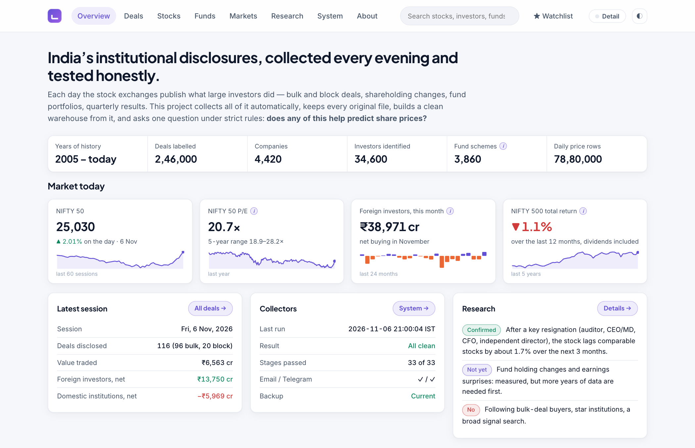

Figure 1. The Overview page: the latest session, the last collection run and the research summary.
{: .caption}

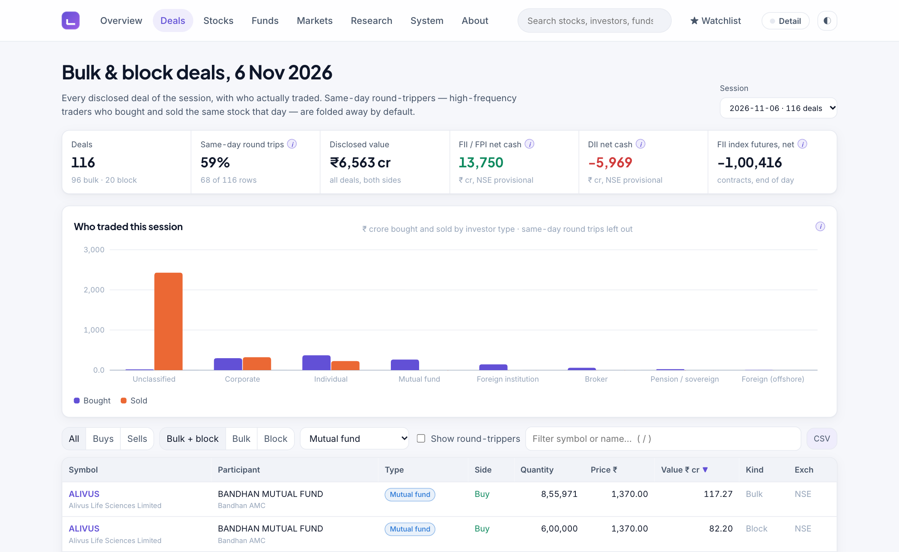

Figure 2. The Deals page, filtered here to mutual funds. Same-day round trips are folded away by default.
{: .caption}

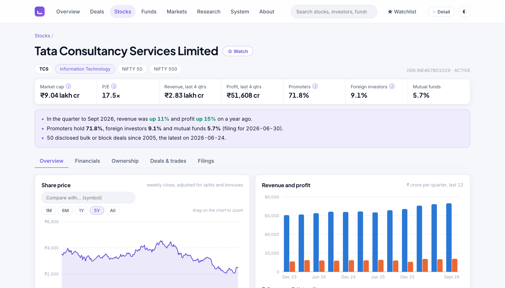

Figure 3. A stock page. All of one company's information is in one place, with no buy or sell label.
{: .caption}

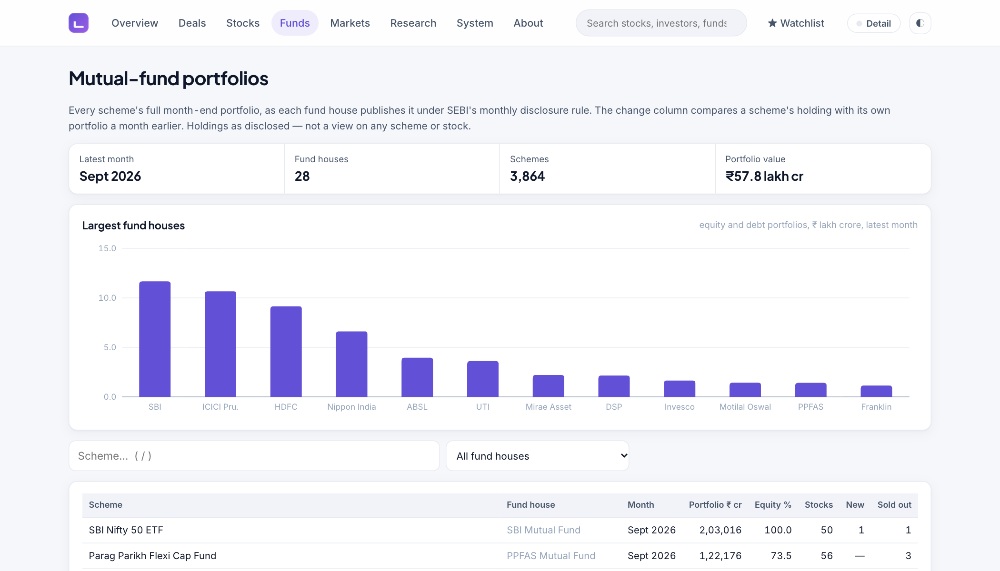

Figure 4. The Funds page: fund houses and their schemes, from month-end portfolios.
{: .caption}

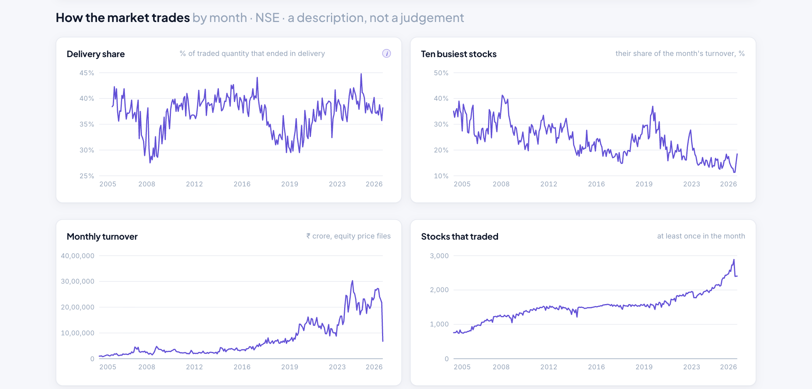

Figure 5. The Markets page, showing how the market trades by month. The fall at the end of the turnover chart is because November 2026 is only part of a month.
{: .caption}

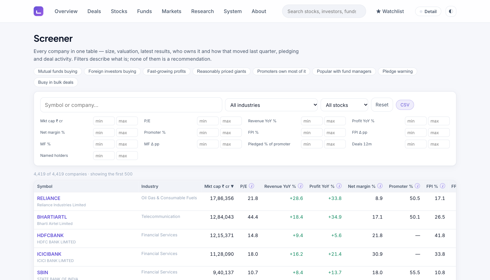

Figure 6. The Screener page: filtering companies on disclosed numbers.
{: .caption}

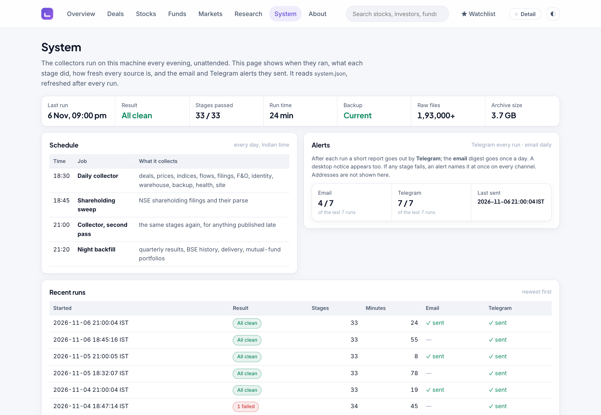

Figure 7. The System page. It shows each run, including a failed one. Nothing is hidden.
{: .caption}

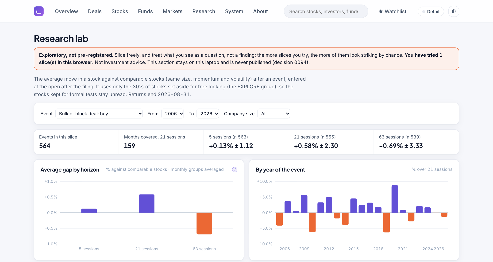

Figure 8. The Research lab, showing one example view. It carries a clear warning, and it stays on my laptop.
{: .caption}

### 7.5 What the data showed

With all this data in one place, I could test some popular beliefs. For each test, I wrote down the question and the pass mark before looking at the answer, so I could not change them afterwards.

| Question | Answer |
|---|---|
| Does avoiding shares after a bulk deal improve a portfolio? | No |
| Do some institutions keep picking winners? | No |
| Do F&O positions predict the market? | Cannot say: the data is about four times too short |
| Does a rise in institutional holding predict the share? | Cannot say: the data is too short |
| Can a very wide computer search find a working signal? | No |
| Does a stock fall behind similar stocks after a key person resigns? | **Yes** |

The one "yes" is this: after a company reports that its auditor, CEO or MD, CFO or an independent director has resigned, its share falls behind similar shares by about 1.7% on average over the next three months. This is based on 4,894 cases.

**This is not a way to make money.** To use it, you would have to sell shares short, and the costs of doing that were not included. It only describes how prices behaved.

The result that matters most for this project is that public disclosures are useful to read, but they are not a simple signal to buy or sell. That is one more reason the website only shows facts.

Figure 9 shows these answers on the website. The Research lab in Figure 8 lets me explore this kind of question further, but its numbers are only for exploring and are not findings.

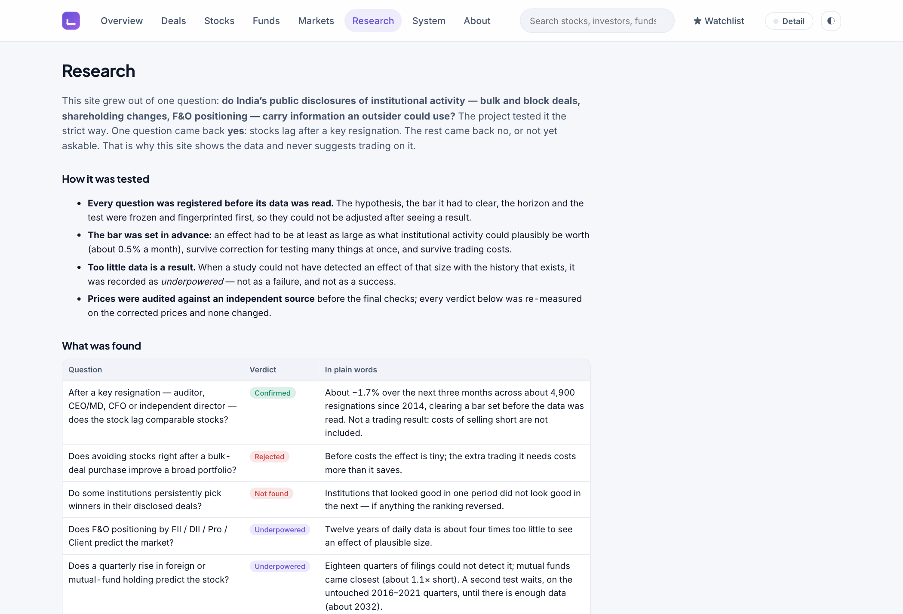

Figure 9. The Research page: what the tests found, in plain language.
{: .caption}

## 8. GitHub status

### 8.1 Where the code is

| | |
|---|---|
| **Repository** | `https://github.com/markandeyavarma3-lab/MICC_V3` |
| **Visibility** | Public |
| **Main branch** | `main` |
| **Commits** | 317, since 16 August 2026 |
| **Automated tests** | **1290 automated tests** in 103 files |
| **Automatic checks** | GitHub Actions runs the basic tests on each push. The latest run, on 7 November 2026, passed |

The website has its own separate repository, `research-website`, with 28 commits. That one stays only on my laptop, because the website is not published.

### 8.2 What is on GitHub and what is not

The source code, tests, plans, decision records and reports are on GitHub. The data (about 19 GB), the databases, and all passwords and keys are not. I run a secret scan before commits, because the repository is public.

### 8.3 Work over time

The repository received 54 commits in August 2026, 116 in September, 128 in October and 19 so far in November.

### 8.4 Latest commits

| Commit | Date | What changed |
|---|---|---|
| `34ab981` | 2026‑11‑07 | Market cap from shareholding filings; mistyped filings and mixed bases on the site |
| `6cd7749` | 2026‑11‑07 | Review report and README: 1284 tests, commit log refreshed |
| `18d6945` | 2026‑11‑07 | Half-yearly results for companies that report only every six months |
| `f401a90` | 2026‑11‑07 | Review report: trimmed to 21 pages, with the first green GitHub run recorded |
| `aff8e78` | 2026‑11‑07 | CI: run on macOS, where the project runs |
| `a700404` | 2026‑11‑07 | CI: install zsh, which the backup tests execute |
| `209de3b` | 2026‑11‑07 | CI: failing test names as public annotations |
| `87a3c4a` | 2026‑11‑07 | Review report: nine plain-English parts, Arial, with screens and the commit log |
### 8.5 Earlier versions

This is the third version of the project. V1 (June to July 2026) collected the first data, 1.13 crore rows that are still in use. V2 (July to August 2026) tried to find trading strategies, and I stopped it after an audit found its costs were calculated wrongly.

## 9. Conclusion

### What was achieved

India's free market disclosures were scattered, some disappeared daily, and they came in many formats with many names for the same thing. This project brings them together.

- **The collector** runs by itself every evening, and has saved more than 1,92,000 original files.
- **The database** holds about 20 years of market history, with companies and investors matched across name changes.
- **The web application** shows 4,419 stocks, 34,601 participants and 3,864 fund schemes in one place, with no advice.
- **The checks** include 1,290 automated tests, a price check against a separate source, and a health report after every run.

### What is not finished

- It runs on one laptop. If the laptop is off, data that is only available for a day can be lost.
- The website is not public yet, as NSE's data rules still have to be checked.
- Some data is missing, as listed in Section 4.6.
- The same trade can appear in both the bulk and block lists, so a day's total value on the website may count it twice.

### What I learned

- **Collecting data is harder than analysing it.** Most of my time went into getting clean, correct data.
- **Measure, do not assume.** Several times, my own earlier results turned out to be wrong when I checked them properly.
- **Save the original.** Every time I found a mistake, the saved file let me fix it.
- **A "no" is a real answer.** Most of the ideas I tested did not work, and knowing this is useful.

### What comes next

- Check NSE's data rules, then decide about publishing the website.
- Keep collecting, so that the questions which are short of data today can be answered later.
- Add the fund houses and sources that are still missing, where they allow it.

### Final word

Free data is only useful if people can find it, trust it and understand it. This project takes India's public market disclosures, which were spread across many places, and makes them available in one place that is simple to read.
